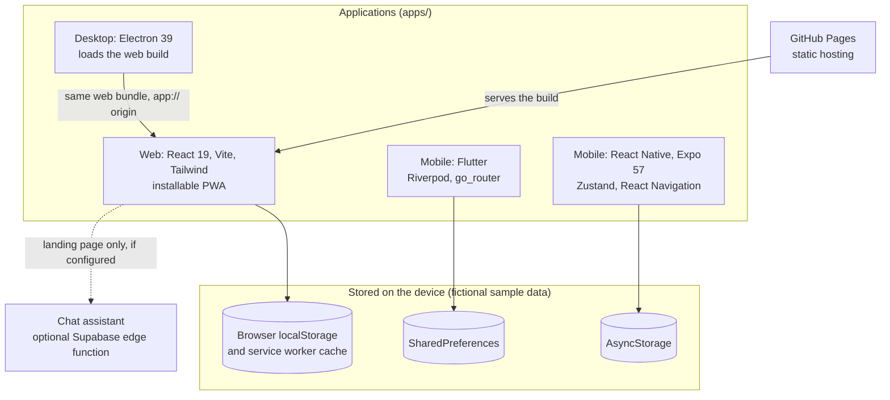
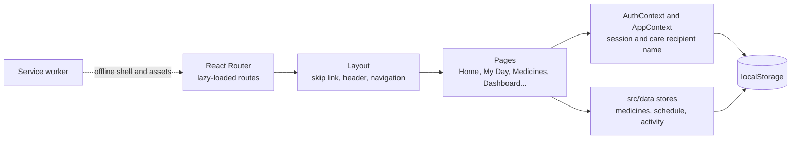
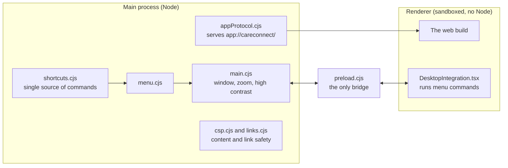
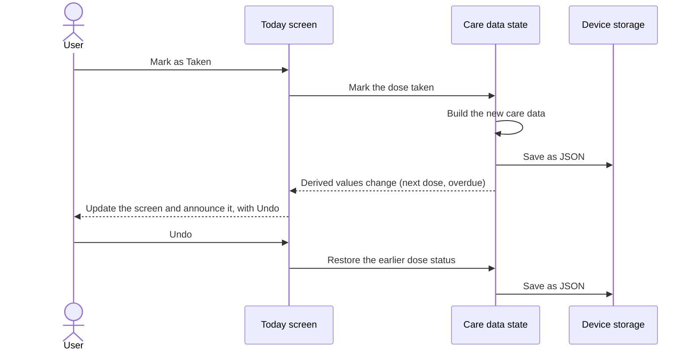
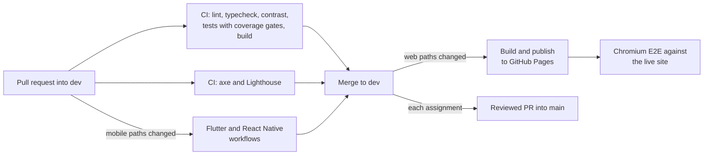

# Architecture

CareConnect is one product built four times: a React web app, an Electron desktop app, a Flutter
mobile app and a React Native mobile app. They all live in this one repository. None of them needs a
backend: each app stores its data on the device.

## System overview



The chat assistant is the only feature that sends what someone types off the device, and it's optional:
without its environment variables the app answers from built-in replies. The web app also downloads its
fonts and Memories photos. All the health data is fictional.

## Repository layout

```text
careconnect-adhd/
├── apps/
│   ├── web/              React web app and PWA (npm workspace)
│   ├── desktop/          Electron shell over the web build (npm workspace)
│   ├── mobile-flutter/   Flutter app (standalone Dart project)
│   └── react-mobile/     React Native + Expo app (standalone npm project)
├── packages/
│   ├── design-tokens/    Color, type and spacing values, plus the CI contrast check
│   ├── mock-data/        Domain types and fictional fixtures
│   └── ui/               One shared component (StepProgress)
├── docs/                 User guide, deployment, testing, accessibility, ADRs
└── .github/workflows/    CI, web deploy, Flutter, React Native, nightly E2E
```

## Framework choices

| App | Stack | Why |
| --- | --- | --- |
| Web | React 19, React Router 7, TypeScript (strict), Vite 5, Tailwind 3 | Course requirement. Vite gives fast builds and route-level code splitting, and Tailwind keeps responsive layouts consistent. |
| Desktop | Electron 39 | Course requirement. Reusing the web build means accessibility fixes on one platform reach the other. |
| Flutter | Flutter 3.47+, Riverpod 3, go_router, shared_preferences | Course requirement. One immutable state object makes undo, autosave and "reset sample data" simple. |
| React Native | Expo SDK 57, React Native 0.86, Zustand, React Navigation 6, AsyncStorage | Course requirement. Expo avoids native build setup, and Zustand maps closely onto the Flutter state design, which made the port easier to check. |

The team recorded its larger decisions in [`docs/decisions/`](decisions/).

## Web app



- **State:** React Context holds the session (`src/auth/AuthContext.tsx`) and the care recipient's name
  (`src/context/AppContext.tsx`). Pages call the stores in `src/data/` directly, and those read and write
  `localStorage`.
- **Accounts:** `src/auth/mockAuth.ts` keeps accounts in the browser. There's no real authentication.
- **PWA:** `public/sw.js` uses network-first for navigation and stale-while-revalidate for hashed
  assets. `src/components/InstallPrompt.tsx` shows the install banner.
- **Resilience:** an error boundary catches failed route chunks and offers a reload.

More detail is in the [web README](../apps/web/README.md).

## Desktop app



The renderer runs with `contextIsolation` and `sandbox` on, and `preload.cjs` is its only bridge to the
main process. `shortcuts.cjs` generates the menu and the Keyboard Shortcuts window, so the two can't
disagree. More detail is in the [desktop README](../apps/desktop/README.md).

## Mobile apps

Both apps use the same structure, so a screen in one has a matching screen in the other.



- **State:** derived values such as the next dose and overdue doses live in one place
  (`care_selectors.dart` in Flutter, `state/selectors.ts` in React Native), and screens only read them.
- **Time:** an injectable clock keeps tests repeatable and powers the **Demo clock** setting.
- **Navigation:** each role gets its own tabs. Signed-out users stay on sign-in through a redirect guard in
  Flutter and by swapping the navigator tree in React Native.

More detail is in the [Flutter README](../apps/mobile-flutter/README.md).

## Code reuse across platforms

| What | Shared how | Between |
| --- | --- | --- |
| All screens, styles and web logic | The same compiled build | Web and desktop |
| Design, screens and data shape | Ported by hand, no shared code | Flutter and React Native |
| Accessibility rules and test approach | Team standards and CI gates | All four |
| Color and contrast values | `packages/design-tokens`, checked in CI | The design system |

**What didn't work as first planned.** The original plan had every app consuming `packages/ui` and
`packages/mock-data`. The web app lists those packages as dependencies but doesn't import them, because it was
adapted from an existing reference app with its own components and data. Flutter can't consume TypeScript
packages, and React Native stays outside the npm workspace as a standalone Expo project. So the real reuse is web to desktop (complete) and design to mobile
(by hand). This is also why the sample data differs: web and desktop inherited Margaret and Joyce, while
mobile uses Muhammad and Renee.

## Build and deployment pipeline



Playwright runs in Chromium, Firefox and WebKit every night and on any pull request with the `run-e2e`
label. See the [Deployment Guide](DEPLOYMENT.md) and [Testing Strategy](TESTING.md).

## Accessibility as architecture

These are structural decisions that make accessibility harder to lose:

- **Contrast is checked in CI.** `check:contrast` fails the build if a documented color pair drops below
  WCAG AA, or a High Contrast color drops below 7:1.
- **CI blocks violations.** Every pull request runs axe and Lighthouse on the built app's public pages, and
  jest-axe tests components in the web test suite. Signed-in screens are scanned separately, by hand.
- **Status is announced in one way.** Polite status regions report changes without moving focus.
- **Color is never the only signal.** Status always has a word or an icon as well.
- **Motion can be turned off.** Web animation sits behind `prefers-reduced-motion`, and Flutter suppresses route
  transitions under the OS reduce-motion setting. React Native doesn't do this yet.
- **Mobile sign-in has no password** (WCAG 2.2 SC 3.3.8).
- **Large targets.** The mobile apps use a 44 by 44 minimum, above the 24 by 24 that WCAG 2.2 SC 2.5.8 requires,
  because mis-taps cost more for this user group.

## Decisions

| ADR | Decision | Status |
| --- | --- | --- |
| [0001](decisions/0001-mobile-framework.md) | Mobile framework | Accepted: both Flutter and React Native |
| [0002](decisions/0002-desktop-os-target.md) | Desktop OS | Open in the ADR. The code supports both Windows and macOS. |
| [0003](decisions/0003-repository-home.md) | Repository home and `dev` branch | Accepted |
