# CareConnect User Guide

CareConnect helps adults with ADHD keep track of medicines, appointments and the day ahead, and
gives a caregiver or support person a clear view of how things are going. It runs on the web, on
Windows and macOS desktops, and on Android and iPhone.

> **This is a course demonstration app.** It runs on sample data, and accounts and care data stay on your
> own device. Nothing is sent to a doctor. CareConnect does not give medical advice. Always take
> medicines as your prescriber directs.

**Live web app:** <https://shaynemcp.github.io/careconnect-adhd/>

## Contents

1. [What CareConnect does](#1-what-careconnect-does)
2. [Get CareConnect on your device](#2-get-careconnect-on-your-device)
3. [Sign in and choose your role](#3-sign-in-and-choose-your-role)
4. [Care recipient screens (web and desktop)](#4-care-recipient-screens-web-and-desktop)
5. [Caregiver screens (web and desktop)](#5-caregiver-screens-web-and-desktop)
6. [The mobile apps](#6-the-mobile-apps)
7. [Desktop extras](#7-desktop-extras)
8. [Accessibility features](#8-accessibility-features)
9. [Frequently asked questions](#9-frequently-asked-questions)
10. [Troubleshooting](#10-troubleshooting)
11. [Known limitations](#11-known-limitations)

---

## 1. What CareConnect does

- **One next step.** The first screen shows the one thing to do next, so you don't have to work
  out where to start.
- **Medicines at a glance.** See what's left to take today and mark each one as taken.
- **Appointments in one place.** See what's today, what's later this week and who is going with you.
- **A caregiver who can see without chasing.** A caregiver sees progress, overdue medicines and
  upcoming appointments.

There are two roles. A **care recipient** manages their own day. A **caregiver** supports them.

---

## 2. Get CareConnect on your device

| Platform | How to get it | Status |
| --- | --- | --- |
| Web browser | Open the [live web app](https://shaynemcp.github.io/careconnect-adhd/) | Available |
| Web, installed as an app | Install from your browser (steps below) | Available |
| macOS desktop (Apple Silicon) | Install the `.dmg` file | Provided with the final submission |
| Windows desktop | Build `CareConnect-Setup.exe` on Windows | See the [Deployment Guide](DEPLOYMENT.md) |
| Android (Flutter) | Install the APK file | Provided with the final submission |
| Android (React Native) | Install an APK built from source | See the [Deployment Guide](DEPLOYMENT.md) |
| iPhone | Run from source with Xcode | No IPA is provided |

### Web browser

1. Open <https://shaynemcp.github.io/careconnect-adhd/>.
2. Choose **Sign up** to create an account, or **Sign in** if you already have one on this browser.

The web app works in current versions of Chrome, Edge, Firefox and Safari.

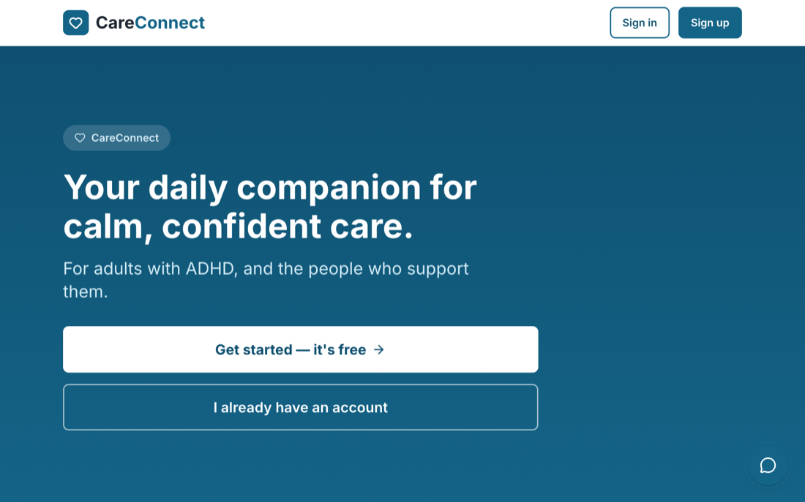

### Install the web app

Installing puts CareConnect on your device like any other app, and it opens even without a connection
once you've used it online.

- **Chrome or Edge on a computer or Android:** when the **Install CareConnect** banner appears, choose
  **Install**. You can also use the install icon in the address bar.
- **Safari on iPhone or iPad:** the banner doesn't appear. Tap **Share**, then **Add to Home Screen**.

### macOS desktop

1. Open `CareConnect-macOS-arm64.dmg` and drag **CareConnect** to **Applications**.
2. Open CareConnect. The app isn't notarized by Apple, so macOS may say it can't verify it.
3. If that happens, go to **System Settings > Privacy & Security**, scroll down and choose **Open Anyway**.

This build runs on Macs with Apple Silicon. To remove it, move CareConnect from **Applications** to the Trash.

### Windows desktop

1. Double-click `CareConnect-Setup.exe`.
2. The installer isn't code-signed, so Windows SmartScreen may warn you. Choose **More info**, then
   **Run anyway**.
3. CareConnect opens when installation finishes. To open it later, go to **Start menu > SWEN 661 Team 5 >
   CareConnect** or use the desktop shortcut.

To remove it, go to **Settings > Apps > CareConnect**.

### Android

1. Copy the `.apk` file to your phone, or download it there.
2. Open the file. Android may ask you to allow installs from that source, so allow it for this file.
3. Open **CareConnect** from your apps.

The APK is signed with a development key, which is fine for trying the app but isn't a Play Store
release.

### iPhone

There's no App Store listing or IPA file. A developer with a Mac and Xcode can run the app in the
iOS Simulator or on a connected iPhone using the steps in the
[Deployment Guide](DEPLOYMENT.md).

---

## 3. Sign in and choose your role

### Web and desktop

1. Choose **Sign up**, fill in your name, email address and a password of at least 6 characters, then
   confirm the password. Required fields are marked with an asterisk (*).
2. Choose **Create account**.
3. Choose **I am the Care Recipient** or **I am the Caregiver**.

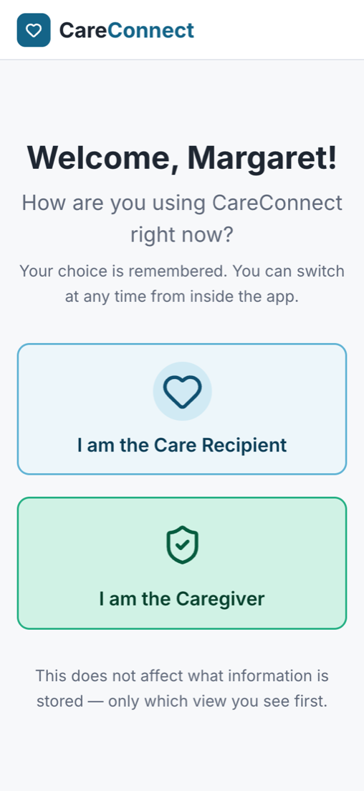

You can change roles any time with the **Switch role** button at the top right of the screen. Care
recipient screens use the sample name Margaret, whatever name you signed up with. Your account is stored only in this browser or app. Signing in on another device means signing up there too.

### Mobile

1. Open the app and answer **I am a…** by choosing your role.
2. Choose **Continue with Face ID / Passkey**, or type an email address and choose
   **Continue with Email**.

There's no password to remember in the mobile apps. Sign-in is a demonstration, so no real passkey
or email check happens.

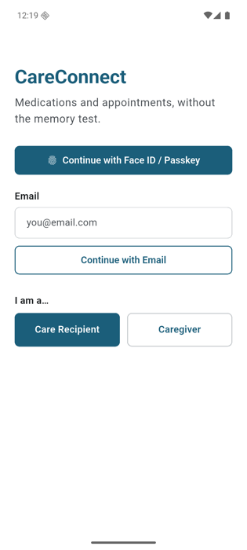

---

## 4. Care recipient screens (web and desktop)

Every screen has the same header: the date and time, a greeting, the name of the current screen and
a **Call my caregiver** button. The tabs at the bottom take you to the six main screens.

### Home

Home answers "what do I do now?".

- **Next thing to do** shows one medicine or appointment with one button: **Mark as taken** or
  **I'm ready**.
- **Later today** lists what's coming up, so you can look ahead without leaving the screen.
- **Quick actions** open Medicines and Appointments, send a **Check In** to your caregiver, or call
  your caregiver.

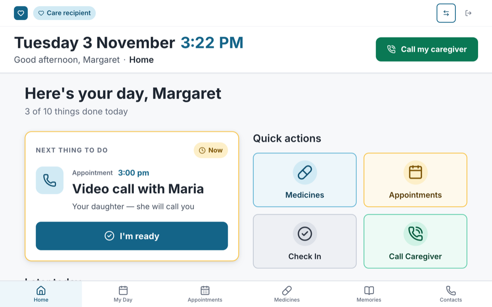

### My Day

My Day is your full schedule for today, in time order, with a progress count at the top. Select the
circle beside an item to mark it done. Colors and words together show each item's category: meal,
medicine, activity, appointment or rest.

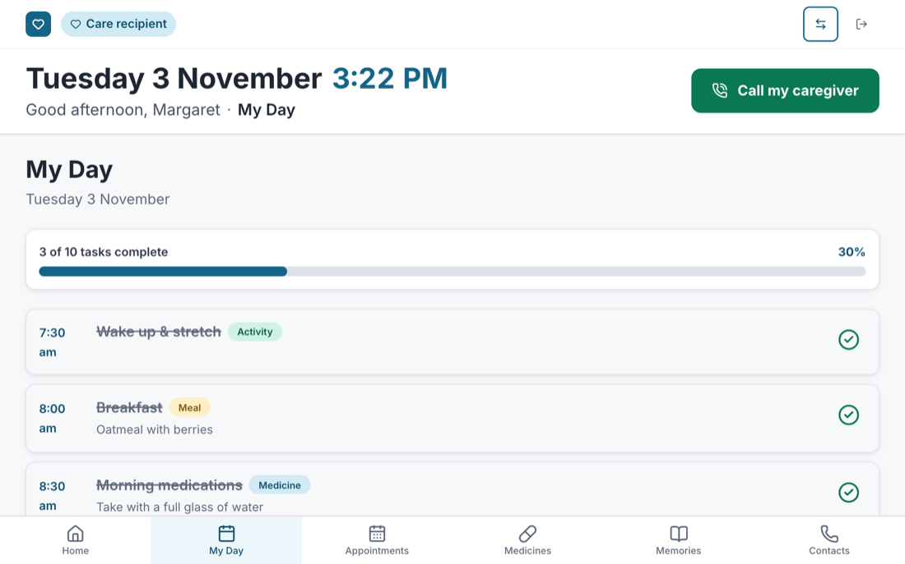

### Appointments

Appointments are grouped into **Today**, **Later this week** and **Coming up**. Each one shows the time,
the place, who is taking you and what to bring.

- **Get directions** opens the location in Google Maps in a new tab.
- **Add to My Day** marks the appointment **In My Day** on this screen. In this demonstration, it doesn't
  change the My Day schedule, and it resets when you reload.

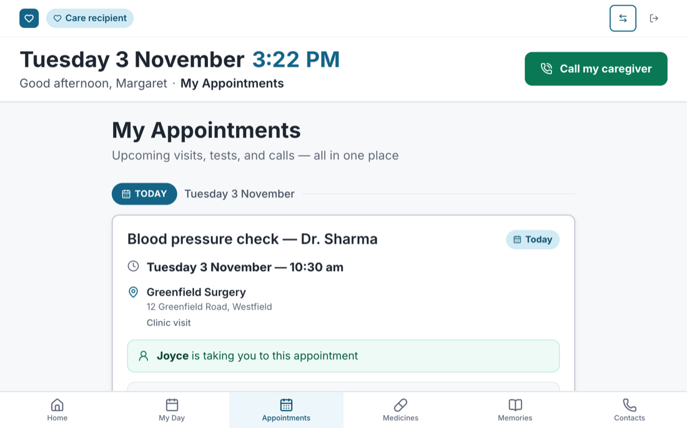

### Medicines

The banner at the top tells you how many medicines you still have to take today.

- Use **Search medicines** to find a medicine by name, dose or instructions.
- Select the circle on a medicine's card to mark it taken. Select it again to undo.

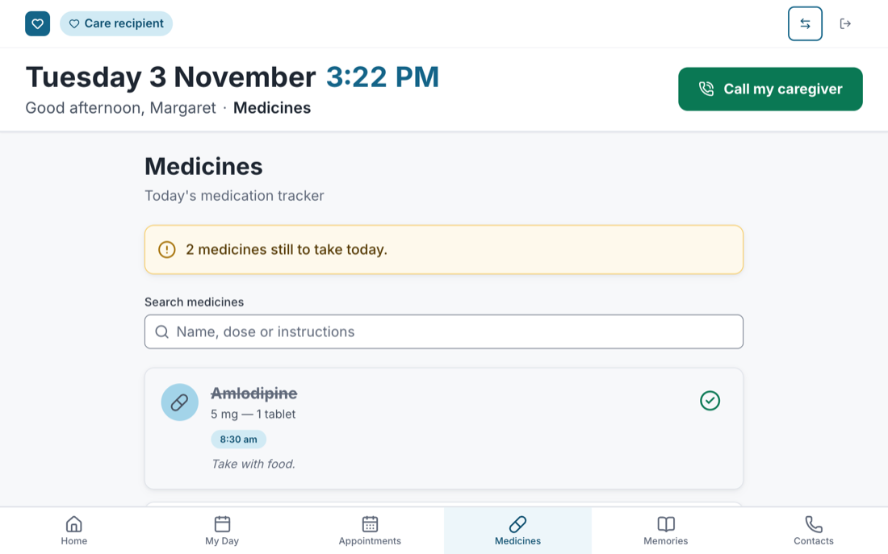

### Memories

Memories holds cards about the people, places and things that matter to you. Use the buttons at the top
to filter by **Family**, **Places**, **Memories**, **Hobbies** or **Pets**, and **Read more** to open a card.

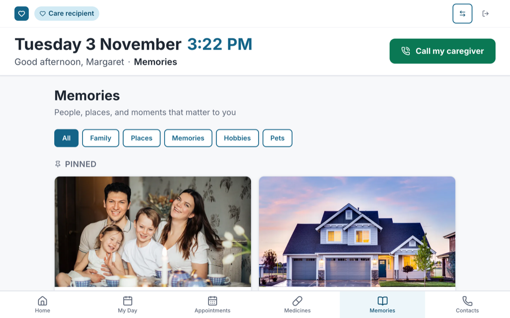

### Contacts

Contacts lists the people who can help you, with emergency contacts first. Select a phone number to call
it. On a computer, this opens whichever calling app your computer uses.

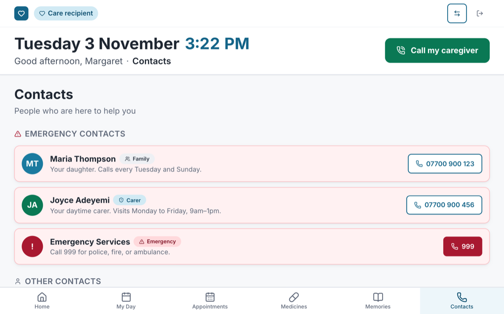

---

## 5. Caregiver screens (web and desktop)

Caregiver screens use a side menu on wide screens and top tabs on smaller ones.

### Dashboard

The Dashboard shows the care recipient's status today (medicines taken, check-in and next appointment),
**Alerts** such as an overdue medicine, **Recent activity** and quick links to the other screens.

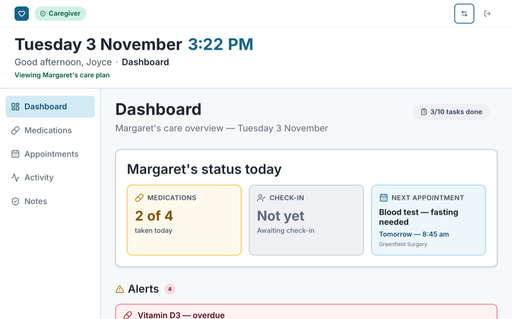

### Medications

**Add medication** opens a form, and each card has **Edit** and **Delete**. Delete asks you to confirm first.
If a required field is missing, the form lists what to fix and marks each field.

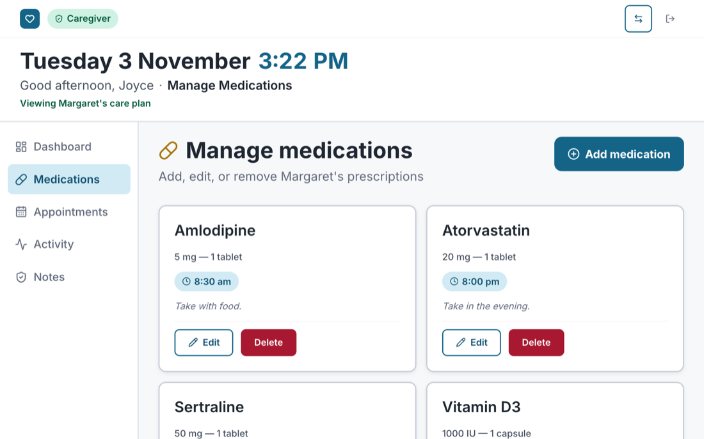

### Appointments

This screen works the same way: **Add appointment**, with **Edit** and **Delete** on each one.

### Activity

The Activity log lists medicines taken, unmarked, skipped or shared, and check-ins. Choose
**Refresh** to see the latest events. In this demonstration, activity only appears for actions taken on
the same browser or device, because there's no server to share it.

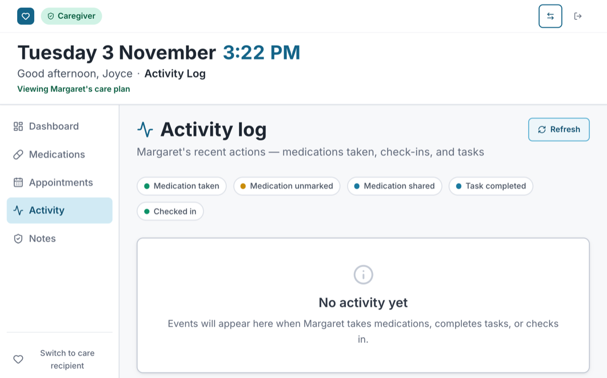

### Notes

Choose **Add note** to record an observation for the care team, and set its priority to **Routine**, **Note**
or **Urgent**.

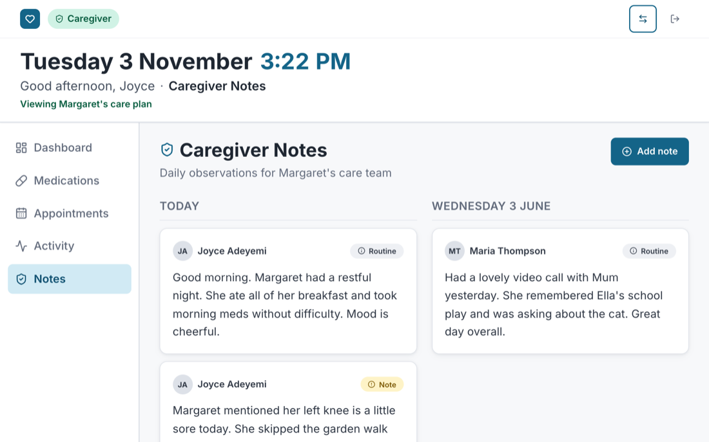

---

## 6. The mobile apps

CareConnect has two mobile apps, one built with Flutter and one with React Native. They share the same
design and the same features, and both differ from the web app in the ways listed here.

| Feature | Web and desktop | Mobile (both apps) |
| --- | --- | --- |
| First screen | Home | Today |
| Full-day schedule | My Day | No (Today lists doses due later) |
| Medicines | Medicines (Medications for caregivers) | Medications, with a detail screen for each |
| Appointments | Yes | Yes |
| Memories | Yes | No |
| Contacts | Yes | No |
| Caregiver notes | Yes | No |
| Settings screen | No | Yes (notifications, caregiver access, theme) |
| Sign-in | Email and password | Passkey or email, no password |
| Sample people | Margaret and her caregiver Joyce | Muhammad and his caregiver Renee |

### Today

The top of the screen shows the date and time. Below that is one main card for the next dose, with the
action button, and then **Later today**.

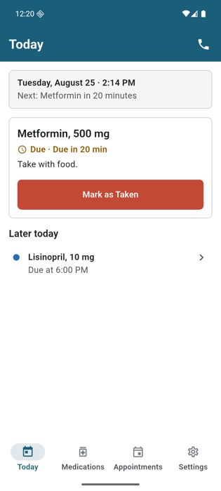

### Medications

Each medicine shows its status in words and with an icon, such as due, overdue or skipped. Select one to
see its schedule and today's doses, where you can mark or skip a dose, or edit or delete the medicine.

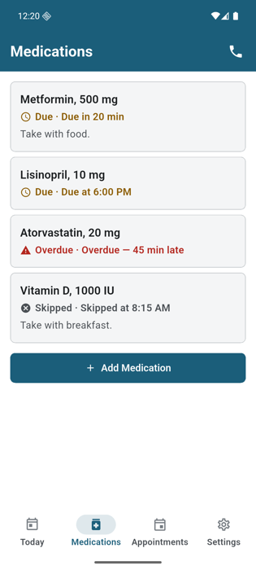

### Undo

When you mark a dose as taken, an **Undo** button appears. In the Flutter app it stays until you close it.
In the React Native app it disappears after 10 seconds.

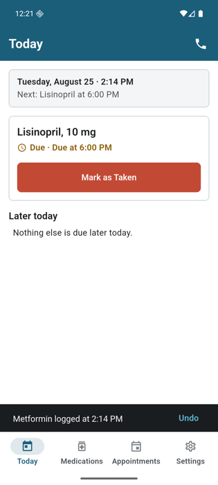

### Caregiver screens

- **Dashboard** shows what needs attention today, including overdue doses, and the next due dose with a
  **Log now** button.
- **Manage** lists medications and appointments to add or edit. The forms go step by step and save your
  draft as you go.
- **Activity** is a timeline grouped by day, with filters.

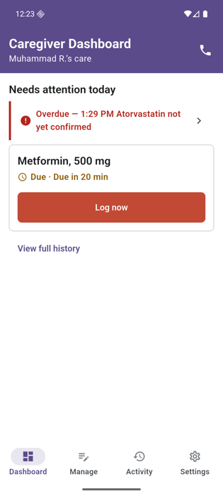

### Settings

- **Notifications** sets up the daily digest, overdue alerts and how far in advance reminders come.
- **My Caregiver Access** lists exactly what your caregiver can see and has a switch to pause sharing. In
  this demonstration, the switch is saved but doesn't change the caregiver's screens.
- **App Settings** has the theme (System, Light or Dark), a demo clock, **Reset sample data** and
  **Sign out**.

Notification settings can be changed, but this demonstration doesn't send real notifications.

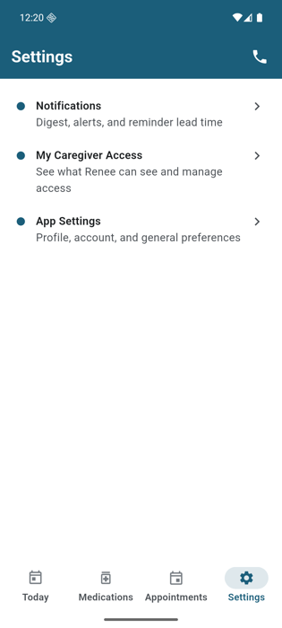

---

## 7. Desktop extras

The desktop app shows the same screens as the web app, and adds a menu bar, keyboard shortcuts, zoom and
High Contrast mode.

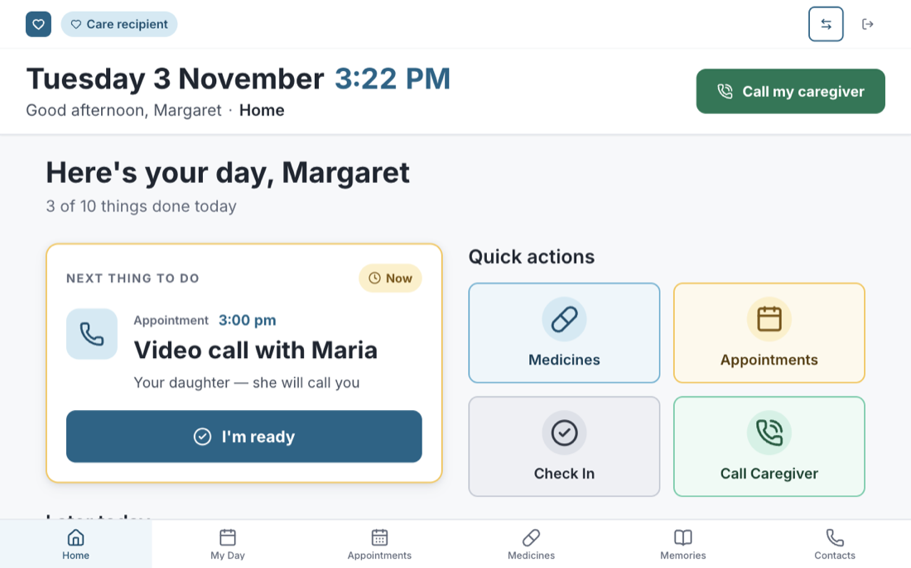

### Common keyboard shortcuts

| Action | Windows | macOS |
| --- | --- | --- |
| Home | `Ctrl+1` | `⌘1` |
| Medicines | `Ctrl+2` | `⌘2` |
| Appointments | `Ctrl+3` | `⌘3` |
| My Day | `Ctrl+4` | `⌘4` |
| Caregiver Notes | `Ctrl+5` | `⌘5` |
| Activity Log | `Ctrl+6` | `⌘6` |
| New Medication | `Ctrl+N` | `⌘N` |
| New Appointment | `Ctrl+Shift+N` | `⇧⌘N` |
| Mark Next Dose Taken | `Ctrl+Enter` | `⌘↩` |
| Skip Next Dose | `Ctrl+Shift+S` | `⇧⌘S` |
| Undo Last Dose Change | `Ctrl+Shift+U` | `⇧⌘U` |
| Call My Caregiver | `Ctrl+Shift+C` | `⇧⌘C` |
| Zoom In / Zoom Out / Actual Size | `Ctrl+=` / `Ctrl+-` / `Ctrl+0` | `⌘=` / `⌘-` / `⌘0` |
| High Contrast | `Ctrl+Shift+H` | `⇧⌘H` |
| Find | `Ctrl+F` | `⌘F` |
| Show all shortcuts | `Ctrl+/` or `F1` | `⌘/` or `F1` |

On Windows, you can also open menus with `Alt` and a letter: `Alt+F` File, `Alt+E` Edit, `Alt+V` View,
`Alt+D` Dose and `Alt+H` Help.

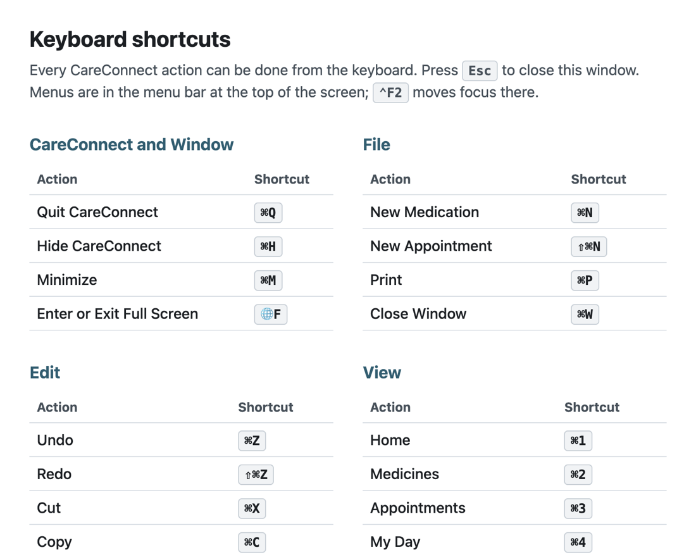

---

## 8. Accessibility features

CareConnect is built to WCAG 2.1 Level AA and the newer WCAG 2.2 AA criteria, with extra attention to
focus, memory and overwhelm. [Section 11](#11-known-limitations) lists where it falls short today.

### Keyboard

- Every action on web and desktop works without a mouse.
- **Skip to main content** is the first thing you reach with `Tab` on the landing page and signed-in screens.
- The item you're on always has a visible outline.
- Confirmation dialogs keep focus inside until you close them, and `Esc` closes them.

### Screen readers

The apps have been tested with NVDA on Windows, VoiceOver on macOS and iOS, and TalkBack on Android.
Status changes such as "1 medicine still to take today" are announced without moving your place on the page.

### Seeing the screen

- **High Contrast** (desktop): `Ctrl+Shift+H` or `⇧⌘H` turns on stronger text and borders, with tinted
  backgrounds replaced by white. It's on the **View** menu.
- **Dark theme** (mobile): choose it in **App Settings**.
- **Zoom:** the desktop app zooms to 200%, and the web app reflows at browser zoom without sideways
  scrolling.
- **Text size** (mobile): the apps follow your phone's text size setting.
- **Color is never the only signal.** Status always has a word or an icon as well.

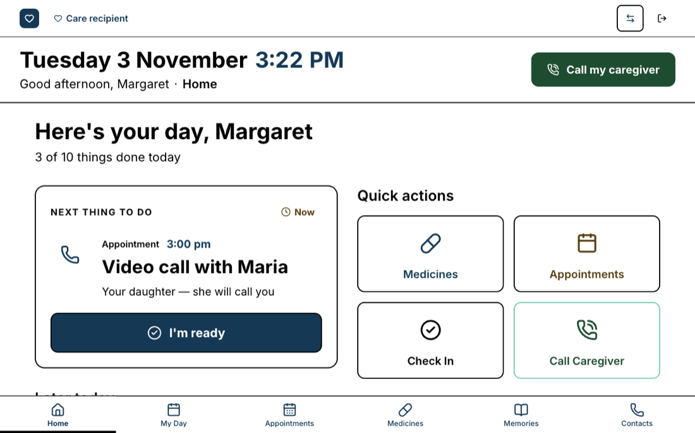

### Motion

If your device is set to reduce motion, the web and desktop apps turn off non-essential animation, and
the Flutter app turns off screen transitions. The React Native app doesn't follow this setting yet.

### Focus and memory

- One main action on each screen, so there's less to decide.
- Medicine and appointment status stays visible, so you don't have to remember it.
- Actions can be reversed, and destructive ones ask you to confirm.
- Long forms on mobile go step by step and save your draft.
- Large tap targets on mobile make mis-taps less likely.

---

## 9. Frequently asked questions

**Is my information private?**
Yes. Your account and data stay on your device. Fonts and Memories photos download from the internet, but
that doesn't send your data. The only exception is the optional chat assistant on the
web landing page: when it's turned on, what you type there is sent to get an answer, so don't enter
personal or health details.

**Does it cost anything?**
No.

**Is the medical information real?**
No. All the medicines, appointments and people are sample data. CareConnect doesn't give medical advice.

**Will my caregiver get my updates on their own phone?**
Not in this demonstration. There's no server, so roles only share data on the same browser or device.

**Will the app actually call someone or remind me?**
On web and desktop, **Call my caregiver** opens your device's phone link with a sample number. In the mobile
apps, calling and notifications are demonstrations only.

**Can I use it offline?**
Yes, for the web app once you've opened it online at least once. A notice tells you when you're offline.
The desktop and mobile apps don't need a connection, although on desktop the fonts and Memories photos may
not load without one.

**I forgot my password. What now?**
This is a demonstration, so any password works on the sign-in screen as long as you use the same browser.

**How do I start over?**
On mobile, go to **App Settings > Reset sample data**. On the web, clear this site's data in your browser
settings. This erases your account in that browser.

---

## 10. Troubleshooting

| Problem | What to try |
| --- | --- |
| A screen says "Something went wrong" | Choose **Reload the page**. This can happen right after a new version is published. |
| The web app shows old content | Reload the page once more. The app updates in the background. |
| The Install banner doesn't appear | It only appears in Chrome and Edge. On iPhone or iPad, use **Share > Add to Home Screen**. |
| I can't sign in on a new device | Accounts stay on the device they were made on. Sign up again there. |
| Windows warns about the installer | The installer isn't code-signed. Choose **More info**, then **Run anyway**. |
| macOS says it can't verify CareConnect | The app isn't notarized. Go to **System Settings > Privacy & Security** and choose **Open Anyway**. |
| Android won't install the APK | Allow installs from the app you opened the file with, then try again. |
| Mobile doses look logged in the future | The sample data is set up when you first open the app. Use **Reset sample data** or turn on the **Demo clock** in **App Settings**. |
| `Tab` doesn't reach links in Safari | This is a Safari setting. Press `Option+Tab`, or turn on **Press Tab to highlight each item on a webpage** in Safari's settings. |
| The chat assistant gives short answers | That's its built-in mode, used when no assistant service is connected. |

---

## 11. Known limitations

These are open issues the team has documented, so you know what to expect.

**Web and desktop**

- NVDA runs some status badges into the next word, such as "Coming upAppointment".
- Confirmation dialogs open on **Cancel**, but VoiceOver doesn't read the question until you move to it.
- After the Skip dialog closes, the returned focus isn't always visible.
- The Keyboard Shortcuts window doesn't switch to High Contrast.

**Flutter**

- VoiceOver doesn't announce form errors on iOS.
- Some text field outlines have low contrast.
- At the largest text sizes, app bar titles can cut off.

**React Native**

- On iOS, the appointment date and time pickers can save the wrong values.
- **Undo** disappears after 10 seconds, which is short for screen reader users.
- Screen readers read some decorative icons.

The full, criterion-by-criterion results are in the team's Accessibility Conformance Reports (VPATs). See
[Accessibility](ACCESSIBILITY.md) for where to find them.
